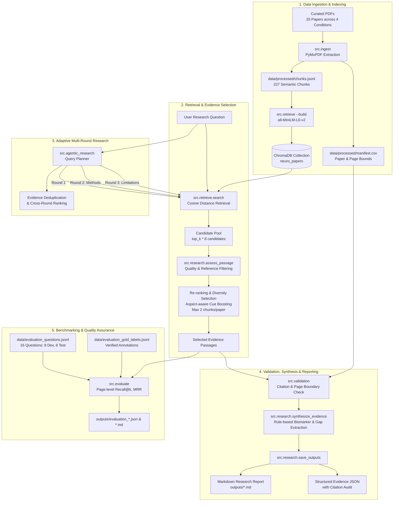

# Neuro Literature Research Copilot: Architecture & Design

## System Architecture

## Component Overview

### 1. Ingestion (`src/ingest.py` & `src/build_corpus.py`)
- Extracts text page-by-page using PyMuPDF (`fitz`).
- Generates sliding-window chunks with metadata (`paper_id`, `condition`, `condition_key`, `page`, `chunk_index_on_page`).
- Produces `manifest.csv` tracking physical page counts and character extraction counts.

### 2. Semantic Retrieval (`src/retrieve.py`)
- Employs `sentence-transformers/all-MiniLM-L6-v2` with normalized cosine embeddings.
- Persists embeddings in a local ChromaDB collection (`neuro_papers`).
- Caches model and database instances in memory for sub-second query performance (~0.5s per query vs ~5.5s uncached).
- Supports optional condition filtering (`--condition {alzheimers, epilepsy, parkinsons, schizophrenia}`).

### 3. Evidence Quality & Noise Filtering (`src/research.py`)
- **Bibliography and Reference Filtering:** 5 heuristic rules identifying reference headings, numbered bibliography entries, author-year patterns, dense DOI/URL clusters, and publication metadata.
- **Publisher Metadata Filtering:** Identifies journal banners, license strings, and DOI patterns.
- **Boilerplate Detection:** Filters generic scanner parameters (TR, TE, FOV) and institutional review board consent templates.
- **Uninformative Stub Elimination:** Flags short header/title snippets (<260 chars) lacking scientific evidence.
- **Aspect-Aware Re-ranking:** Detects question intent (methodologies vs. limitations) and boosts passages containing explicit domain cues.
- **Paper & Page Diversity:** Caps top results to prevent single-paper saturation, ensuring multi-paper evidence synthesis.

### 4. Citation and Source-Page Validation (`src/validation.py`)
- **Format Validation:** Validates citation strings (`ALZ01, p. 4`, `PAR07, pp. 2-4`).
- **Source-Page Boundary Checks:** Verifies paper IDs and checks that page numbers are within actual document bounds.
- **Evidence Integrity Checks:** Verifies evidence items have required keys, non-empty passages, and grounded citations.
- **Report Auditing:** Scans generated Markdown reports and generates a 100% verification audit in the companion JSON file.
- **Groundedness Verification:** Checks verbatim quotes against indexed chunks using substring and token overlap.

### 5. Deterministic Adaptive Research Planner (`src/agentic_research.py`)
- **Multi-Round Execution:**
  - Round 1: Original user research question.
  - Round 2: Targeted search for imaging modalities, signal features, and ML models.
  - Round 3: Targeted search for dataset biases, validation pitfalls, data leakage, and clinical limitations.
- Combines, deduplicates, and re-ranks evidence across rounds.
- Generates reproducible research reports and structured evidence JSON traces.
